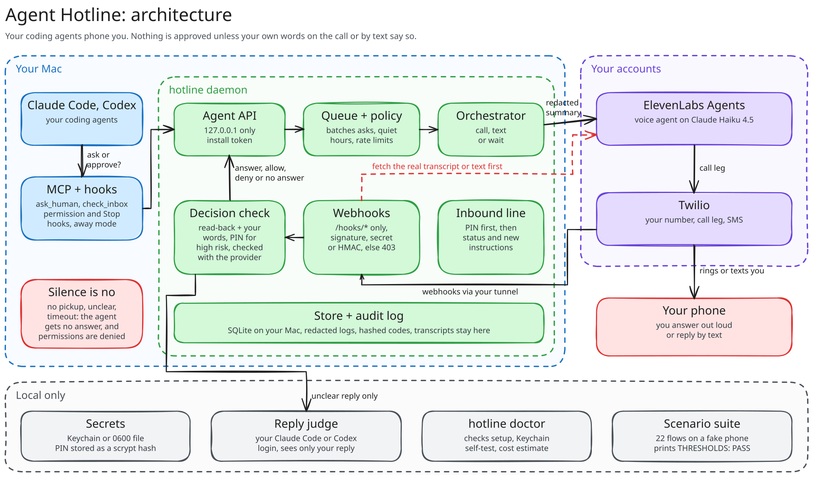

<div align="center">

# Agent Hotline

**Your coding agents call your phone when they need you. You answer out loud, and they keep working.**

[](https://github.com/neanicc/agent-hotline/actions/workflows/check.yml)
[](LICENSE)


[How it works](#how-it-works) · [Install](#install) · [Usage](#usage) · [Results](#results) · [Limitations](#limitations) · [Security and privacy](#security-and-privacy) · [Costs](#costs) · [Build from source](#build-from-source)

<!--
  TODO (after the live check, #76): replace the block below with the demo.
  Record it with a throwaway project and made-up details only. Example:

  <a href="https://www.youtube.com/watch?v=VIDEO_ID">
    
  </a>
  <br><em>▶ Watch the full demo</em>
-->
<table><tr><td align="center" width="760">
<br>
<b>Demo video coming soon</b><br>
<sub>It'll show Claude Code phoning about a permission prompt and getting a spoken yes.</sub>
<br><br>
</td></tr></table>

</div>

---

You start Claude Code or Codex on a task and walk away. Twenty minutes later it hits a permission prompt, or a question only you can answer, and it sits there until you come back.

Agent Hotline rings your phone instead:

> "Hey, it's Claude in agent-hotline. It wants to run `pnpm test` in demo-app. Should I let it?"

You answer the way you'd answer a person. The agent gets your answer and carries on. If you don't pick up, or it's quiet hours, you get a text and can reply to that. You can also call the number yourself, give your PIN, hear what every agent is doing, and give one of them a new instruction.

> [!IMPORTANT]
> **A phone line that can steer coding agents is a remote control for your machine.** Hotline only takes answers from your own number, checks every webhook, confirms each decision with Twilio or ElevenLabs before it counts, and treats silence as no. It is pre-release and nobody has run it on a live call yet ([live check](#live-check)).

## Features

| | |
| --- | --- |
| **Phone calls** | ElevenLabs Agents places the call through your Twilio number and reads the agent's question aloud. Pick any ElevenLabs voice, including a clone of your own ([docs/voice.md](docs/voice.md)). |
| **Natural answers** | Say yes, no or anything in between. Before approving anything the voice agent reads the request back in one sentence ("Allow Bash: pnpm test, for Claude in demo-app? Yes?") and waits for your yes. If it can't tell, it asks again, and after two unclear replies it texts you. |
| **Permission prompts** | Claude Code's and Codex's own permission and Stop hooks reach you while you're away. Risky commands, such as deleting files, `git push` or anything touching credentials, also need your PIN. |
| **Questions** | Agents ask through an MCP server (`ask_human`, `notify_human`, `check_inbox`) and get your answer back as a tool result. |
| **Texts** | No pickup or quiet hours turns a call into a text. Reply with an option number, yes or no, free text, `call me`, `status` or `stop`. Approving a permission by text needs the one-time code in the message. |
| **Call in** | Dial your number, give your PIN, hear every session's status, and leave an instruction for one of them. It reaches that agent at its next question or Stop. |
| **Several agents, one call** | Asks that arrive close together share one call. Rate limits, quiet hours and loop guards are always on. |
| **Local first** | The daemon runs on your Mac. Config, the PIN hash, transcripts and the audit log stay there. Only short, redacted summaries go to Twilio and ElevenLabs. |

## How it works



<sub>Drawn in Excalidraw. To edit it, open <a href="docs/architecture.excalidraw"><code>docs/architecture.excalidraw</code></a> or the SVG, which embeds the scene, at <a href="https://excalidraw.com">excalidraw.com</a>.</sub>

1. **Ask.** An agent calls `ask_human`, or hits a permission prompt or a Stop while away mode is on. The MCP server or hook sends the ask to the daemon's agent API on 127.0.0.1, with a per-install token.
2. **Decide how to reach you.** The queue batches asks from several agents, then call policy picks a call, a text or a short wait, based on quiet hours, rate limits and retries.
3. **Call.** The orchestrator hands ElevenLabs a short, redacted summary. ElevenLabs calls you through Twilio, and its voice agent, running on Claude Haiku 4.5, reads the question, reads approvals back and asks for your PIN on risky ones.
4. **Check.** ElevenLabs and Twilio report back through your tunnel to `/hooks/*`, the only public routes. Hotline treats each webhook as a trigger only: it fetches the real transcript or text message from the provider, then confirms the decision against your own words. Replies it can't decide go to a reply judge running on your own Claude Code or Codex login, which sees only your short reply.
5. **Answer.** The agent gets your answer, an allow or deny, or the next instruction. No pickup, an unclear answer or a timeout comes back as "no answer", and a permission prompt is denied.

The core library, `packages/core`, is pure and has no I/O, which is why the whole flow runs end to end against a fake phone in CI. Design notes live in [docs/plan.md](docs/plan.md), [docs/daemon.md](docs/daemon.md), [docs/hooks.md](docs/hooks.md), [docs/mcp.md](docs/mcp.md) and [docs/security.md](docs/security.md).

## Install

> [!NOTE]
> **Hotline isn't on npm yet.** You build the `hotline` command from a checkout. You can try everything except the phone itself with the fake providers, with no accounts at all.

You need:

- A Mac that stays awake while you're away, with Node 22 ([.node-version](.node-version)) and Corepack.
- Claude Code and/or the Codex CLI.
- For real calls, accounts you set up and pay for yourself: Twilio (upgraded from trial, with a number), ElevenLabs (Starter plan or above), and a tunnel with a fixed URL, such as an ngrok free static domain. Hotline never creates accounts.

1. **Build the command.**
   ```sh
   corepack enable
   pnpm install --frozen-lockfile
   pnpm run package          # bundles the CLI into dist/hotline (gitignored)
   ln -s "$PWD/dist/hotline/bin/hotline" ~/.local/bin/hotline   # any folder on your PATH
   hotline --version
   ```
   `dist/hotline` runs on plain Node and needs no `node_modules`.
2. **Set it up.** `init` asks for your number, PIN and credentials, and whether to turn on the reply judge. The tunnel URL, your Twilio number and its ElevenLabs phone-number id go in as flags.
   ```sh
   hotline init --public-url https://<your-tunnel-domain> \
     --sms-from <your Twilio number> --agent-phone-number-id <ElevenLabs id>
   hotline voice apply             # create the ElevenLabs agent and its tools
   hotline install claude          # and/or: hotline install codex (backs up and shows a diff)
   hotline daemon                  # in its own terminal; start your tunnel too
   hotline doctor                  # until there are no FAIL lines
   hotline test-call               # rings your phone once
   ```
3. **Turn on post-call retries in ElevenLabs.** In the agent's webhook settings, enable retries for the post-call webhook. Hotline answers 503 while a call record is still processing, and without retries that answer is lost.

To try it without accounts, run `hotline init --voice-provider fake --sms-provider fake` and skip `voice apply`. [docs/install.md](docs/install.md) has every flag and check, and [docs/demo.md](docs/demo.md) is a walkthrough for a screen recording.

## Usage

1. **Before you walk away, run `hotline away on`.** Hooks only phone you in away mode. When you're back, `hotline away off` hands prompts back to the terminal.
2. **When your phone rings, just talk.** Answer the question, or say yes or no to a request. For a risky command the voice agent asks for your PIN first. If it reads a request back, any clear yes approves it. A no takes effect at once.
3. **If you miss the call, reply to the text.** Send an option number, yes or no, or free text. Approving a permission by text needs the code in the message, as in `YES 482913`. Text `call me` to get a call now, `status` for a summary, or `stop` to stop the texts.
4. **To check in, call your Hotline number.** Give your PIN, hear each session's status, and say something like "for session two, run the tests". The agent reads it back, you confirm, and the instruction reaches that agent at its next question or Stop.

<details>
<summary><b>Settings at a glance</b></summary>

| Setting | Default | What it does |
| --- | --- | --- |
| Rate limits | 4 calls an hour, 20 a day | Extra asks wait for a slot or go by text |
| Quiet hours | 22:00 to 08:00, in the time zone `init` sets | Asks become texts unless one is marked urgent and urgent calls are allowed. Change the window with `quietHours.start` and `quietHours.end` |
| Ask timeout | 30 minutes | When it passes, the agent gets "no answer" |
| Away-mode loop guard | 5 continuations in a row | At the cap the agent stops, and you get a notice |
| Voice model | Claude Haiku 4.5 | `voice.llm` switches to Claude Sonnet 4.6 or 5.5 |
| Reply judge | Off until you choose | `judge.backend`: `auto`, `claude-code`, `codex`, `anthropic-api` or `off` |

[docs/contracts.md](docs/contracts.md) has the full config reference.

</details>

## Results

### Scenario suite

`bash scripts/ci/run.sh eval --local` runs the real daemon, MCP server and hook adapters against a fake phone, fake texts and scripted humans with a fake clock, then scores the run against [eval/thresholds.toml](eval/thresholds.toml). On `main` at `8b25518`, every required scenario passes, both in CI on Ubuntu and in a local run on macOS. CI on macOS runs the unit tests and the suite's self-test, not the full suite.

| Area | Scenarios | Result |
| --- | --- | ---: |
| Answers | answered by voice, answered by text, two agents on one call | **3/3** |
| Permissions | approved, denied, high risk needs the PIN, agent text can't approve itself | **4/4** |
| Silence and fallbacks | silence denies, unclear answer denies, no pickup falls back to text, quiet hours texts instead, rate limit holds calls | **5/5** |
| Away mode | continues Claude Code, continues Codex, stop loop capped | **3/3** |
| Inbound line | status with PIN, wrong PIN rejected, other numbers rejected, instruction delivered | **4/4** |
| Webhooks and privacy | unsigned webhook rejected, replayed webhook rejected, secrets redacted before sending | **3/3** |

A self-test proves the suite can fail. A deliberately broken build that approves everything has to fail `silence-denies`, `high-risk-needs-pin` and `agent-text-cannot-self-approve`, and it does. [docs/eval.md](docs/eval.md) defines each one. A fake phone is still a fake phone, so none of this proves a real call works.

### Live check

<!--
  TODO (after the live check, #76): fill in this table from docs/live-check.md.
  Keep recordings, transcripts and phone numbers out of Git.
-->

| Check | Result |
| --- | --- |
| Tested on | _pending: Mac, Claude Code and Codex versions_ |
| A real Claude Code question answered by voice | _pending_ |
| A real Codex permission approved, and another denied, by voice | _pending_ |
| Inbound call with the PIN reads status; another number is rejected | _pending_ |
| Text fallback and `YES <code>` approval | _pending_ |
| Voice turn latency on Claude Haiku 4.5 | _pending_ |

[docs/live-check.md](docs/live-check.md) has the full protocol.

## Limitations

- **Nobody has run it on a real phone yet.** Every test uses fakes. The live check above tracks this.
- **Strict approvals can miss.** When a reply can't be confirmed from the transcript, Hotline texts you rather than approve. Expect some misses until the live check measures the rate. The fallback word lists are English only.
- **Instructions wait for a turn to end.** An instruction reaches an agent at its next question or Stop, never mid-turn.
- **The Mac has to be awake and online.** There's no hosted relay.
- **It knows you by caller ID and your PIN, not by your voice.**
- **Two agents only, one human.** Claude Code and Codex are supported. Texts aren't guaranteed to arrive.

## Security and privacy

- **Owner only.** Hotline calls and texts only your number. Anyone else who calls or texts gets a generic reply and learns nothing. Calling in needs your PIN before anything is read out, because caller ID can be faked and the PIN can't.
- **Every webhook is checked twice.** Twilio requests are signature-checked, ElevenLabs tool calls carry a shared secret and post-call webhooks are HMAC-checked; anything else gets 403. Then, before a text or call can decide anything, Hotline fetches the real record from Twilio or ElevenLabs and uses that. A forged webhook has nothing real behind it, so it approves nothing.
- **Decisions come from your words.** An answer counts only from you on the call or by text, checked against the transcript, with the excerpt stored. Text an agent wrote, such as a question or a command preview, is treated as data and can't approve itself.
- **Silence is no.** No pickup, a dropped call, an unclear answer or a timeout returns "no answer", and a permission prompt is denied.
- **Minimum data to third parties.** Twilio and ElevenLabs get short summaries with API keys, tokens, private keys, `.env` values and passwords redacted first. The reply judge, if you turn it on, gets only your short reply, never the request. It runs on your own Claude Code or Codex login. It only uses API billing if you choose `judge.backend: anthropic-api`, or if you leave it on `auto`, have neither CLI installed, and stored an Anthropic API key at `init`. The judge can only fail to confirm. If it errors or times out, your reply counts as not confirmed, never as a yes.
- **Local first.** The agent API listens on 127.0.0.1 with a per-install token, and only `/hooks/*` is reachable through the tunnel. Credentials live in the macOS Keychain or a `0600` file, and the PIN only as a scrypt hash.

<details>
<summary><b>Known limits, accepted for Tier 1</b></summary>

- **Processes running as you can read Hotline's secrets.** That includes coding agents. Forged webhooks don't work, because Hotline checks the provider's own record, but a process with your provider API keys can still use your accounts directly. Use narrowly scoped keys ([contracts.md](docs/contracts.md#secrets-secretsts)).
- **One install token for every agent.** Local sessions can read or cancel each other's asks. None of them can answer one.
- **The risk classifier only sets how much proof is needed.** It picks PIN-or-code versus a spoken yes. Every request still needs your approval, and it reads command text rather than sandboxing it ([hooks.md](docs/hooks.md#risk-classes-plan-question-6)).

[docs/security.md](docs/security.md) has the threat model, where each rule is enforced and tested, and the full list of accepted risks.

</details>

## Costs

About **USD 12–14 a month** for 60 minutes of calls and 200 texts. These rates come from the public Twilio (Canada) and ElevenLabs pricing pages on 2026-10-14. They're assumptions, not quotes.

| Item | Assumed rate | 60 min + 200 texts |
| --- | --- | --- |
| Twilio local number | $1.15 / month | $1.15 |
| Twilio call leg | $0.014 / min | $0.84 |
| Twilio texts, plus carrier fees | $0.0083 + about $0.007 / segment | about $3 |
| ElevenLabs Starter (Agents, voice cloning) | $6 / month, 75 call minutes included, then $0.08 / min | $6 |
| Voice agent model, Claude Haiku 4.5, billed by ElevenLabs | $1 / $5 per million input / output tokens; `doctor` assumes $0.03 / min | about $2 |
| Reply judge on your Claude Code or Codex plan | no extra charge | $0 |

The voice agent runs on Haiku, the cheapest Claude model ElevenLabs offers, because it only talks and calls Hotline's tools while the daemon checks every decision. Rate limits cap the worst case. Calls you place to Hotline add Twilio's inbound rate.

`hotline doctor` prints a monthly estimate from your own last 30 days of calls and texts, priced locally with these rates. They're defined once in code as `DEFAULT_COST_RATES` ([packages/core/src/config.ts](packages/core/src/config.ts)), and you can set your own under `costs` in `config.json` ([install.md](docs/install.md#monthly-cost-estimate)).

## Build from source

```sh
pnpm run build        # tsc project build
pnpm run typecheck    # build plus a typecheck of every test
pnpm run test         # Vitest, all packages, fakes only
pnpm run lint         # Biome (pnpm run format fixes)
pnpm run package      # dist/hotline, plus a smoke run from a temp folder in CI
bash scripts/ci/run.sh eval --local   # the scenario suite
```

CI calls the same steps through [scripts/ci/run.sh](scripts/ci/run.sh) on Ubuntu and macOS ([docs/ci.md](docs/ci.md)). Nothing in this repository, its tests or its CI places a real call or text, or holds a real credential.

| Path | Holds |
| --- | --- |
| `packages/core` | Contracts, config, ask queue, call policy, reply parsing, risk classes (pure) |
| `packages/daemon` | Agent API, webhook routes, call orchestration, store, audit log, reply judge |
| `packages/providers` | Voice and SMS provider interfaces, Twilio and ElevenLabs clients, fakes |
| `packages/agents` | MCP server and hook adapters for Claude Code and Codex |
| `apps/cli` | The `hotline` command |
| `eval` | The scenario suite: runner, scripted humans, self-test |

## License

MIT. See [LICENSE](LICENSE).
